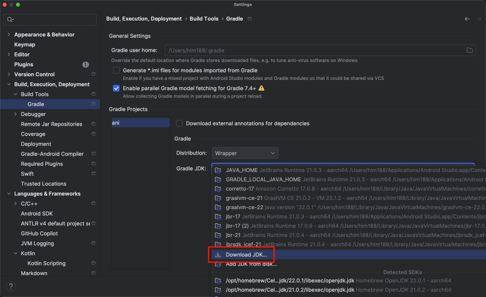
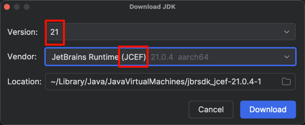

# 开发工具和环境

> 适用范围：当前 NomiKit 工作区的 Android、Desktop 与 iOS 开发环境。
> 最近核对：2026-11-10；源码基线 `cd08542f`。仅静态核对配置，未运行 Gradle 同步或平台构建。

[返回参与开发](<README.md>) · [构建与打包](<building.md>) · [测试与运行](<testing.md>)

## 准备 IDE

使用支持当前 Kotlin / AGP 版本的 Android Studio 或 IntelliJ IDEA。依赖版本以
[Version Catalog](<../../gradle/libs.versions.toml>) 为准，不以旧截图或教程中的版本为准。

- Android 开发需要 Android 支持；Android Studio 已集成主要 Android 工具。
- Compose / Kotlin Multiplatform 插件应选择与 IDE 兼容的版本；插件支持范围会随版本变化。
- 颜色预览、JSONPath 等属于可选辅助插件，不是构建前置条件。
- 可选配色方案：[kamo_dark](<resources/kamo_dark.icls>)。

## 准备 JDK 与 Gradle

工程使用 [Gradle Wrapper](<../../gradle/wrapper/gradle-wrapper.properties>)，不要自行替换为系统
Gradle。 IDE 的 Gradle JDK 与终端的 Java 环境应分别检查，不能假定两者相同。

[默认属性](<../../gradle.properties>) 当前记录了 JetBrains Runtime（JBR）厂商、JDK 17 和带 JCEF 的注释约定；
但 [Android 应用构建配置](<../../app/android/build.gradle.kts>) 与
[KMP 目标约定](<../../buildSrc/src/main/kotlin/multiplatform-lib-targets.gradle.kts>) 当前设置了 JVM
21 编译目标。 这是需要进一步验证的配置差异，本文不再承诺“JDK 17 或 21 均可直接构建”。

首次配置时先核对所选 Gradle / AGP 的运行要求及上述编译目标；若发生 target 或工具链错误，应修正统一构建配置，
不要通过反复切换 IDE JDK 掩盖差异。JCEF 是否为某个应用能力的运行依赖，也应以实际依赖与调用方确认。

IDE 通常在 `Build, Execution, Deployment -> Build Tools -> Gradle` 设置 Gradle JDK。
以下截图仅说明设置入口，不代表当前应安装的版本：




## 配置 Android SDK

1. 打开 IDE 的 SDK Manager。
2. 按 [默认属性](<../../gradle.properties>) 的 `android.compile.sdk` 安装 SDK（本次核对值为 37），
   不再沿用旧文档固定的 SDK 35。
3. 在本机 `local.properties` 中配置 SDK 路径；不要提交个人绝对路径。
4. 真机或模拟器测试另需 ADB 和可用设备，见 [Android 设备测试](<testing.md#android-设备测试>)。

`android.min.sdk` 是应用支持下限，不是应安装的 compile SDK 版本；不要为了运行测试随意提高产品下限。

## 准备 iOS 构建

iOS 构建与运行需要 macOS、Xcode 及相应 SDK。当前工程入口为
[Xcode 工程配置](<../../app/ios/ios.xcodeproj/project.pbxproj>)，打开工程目录而不是内部 Swift 源码目录。

当前配置通过 Gradle Framework 任务接入 Xcode，仓库中未发现 Podfile；不能仅凭旧指南要求每位开发者安装
CocoaPods。 如果后续引入 CocoaPods 集成，再根据实际插件与 Podfile 安装工具。

**已知限制：** Xcode target 当前同时挂载了面向 `:app:shared` 与旧 `:composeApp` 的构建阶段，
后者不在 [模块声明](<../../settings.gradle.kts>) 中。本次未修复工程，也未在 macOS 验证；详见
[iOS 构建说明](<building.md#打包-ios-app>)，不能将工程存在理解为已可运行。

## 导入工程与本机平台开关

Clone 后使用 IDE 打开仓库根目录并同步 Gradle。本次未发现已追踪的 Git 子模块配置，不要求一律使用递归
Clone。 首次同步时间受网络、依赖缓存和本机性能影响，不承诺固定耗时。

平台默认值见 [默认属性](<../../gradle.properties>)：Desktop 和 iOS 开启，Web 关闭。 本机差异优先写入根目录的
`local.properties`，而不是改动共享默认值，例如：

```properties
multiplatform.enable.ios=false
```

禁用 iOS 意味着相关源集不会参与本次验证，不代表 common 代码已经满足 iOS 要求。 若某模块显式访问关闭后的平台源集，Gradle
配置仍可能失败，应检查该模块脚本，不能承诺平台开关适用于所有调用方。

属性读取优先级由 [properties.kt](<../../buildSrc/src/main/kotlin/properties.kt>) 定义：命令行 `-P`、
JVM system property、环境变量、根目录本地属性、根目录 Gradle 属性、extra properties。

## 优化编译速度

- 优先执行改动模块的最窄任务，不用全仓 `clean check` 作为日常入口。
- 不需要的平台按实际任务关闭，但保留未验证平台记录。
- 区分 UP-TO-DATE、FROM-CACHE、SKIPPED
  与实际执行；重复验证方法见 [测试指南](<testing.md#选择最窄验证任务>)。
- 旧指南中的 `multiplatform.android.abis`、`multiplatform.build.framework` 未在本次核对的
  应用与构建逻辑中找到读取点，不再将其列为有效优化开关；恢复使用前须确认实现。

## 核对记录

- 已静态核对：默认 SDK/JDK/平台属性、目标注册脚本、属性优先级、Android 与 Xcode 配置。
- 未执行：Gradle 同步、编译、测试、JCEF 功能检查、macOS / iOS 验证。
- 后续执行时记录日期、Java/IDE/SDK 版本、实际命令与结果；不能以本文命令代替运行记录。
